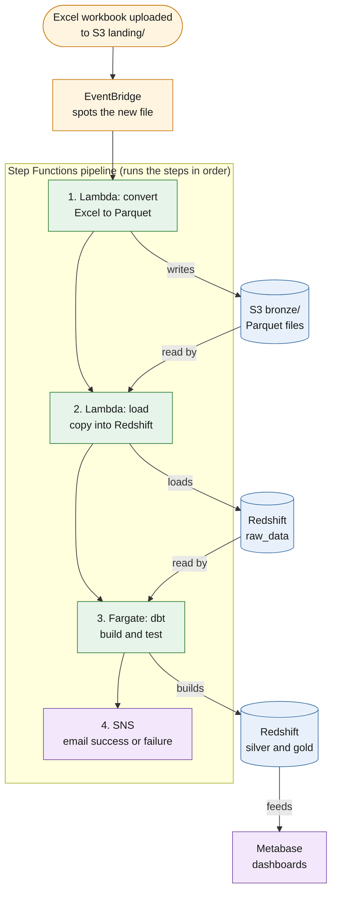

# E-commerce Sales Analytics on AWS

An end-to-end data pipeline for processing e-commerce sales data and making it ready for analysis. The project takes an Excel workbook containing sales transactions, customer information and product details, and moves it through a series of automated processing and transformation steps to produce clean, tested datasets for reporting.

The workflow is built around AWS services, with Amazon S3 handling data storage, AWS Step Functions coordinating the pipeline, and Amazon Redshift Serverless providing the data warehouse. dbt Core handles the transformations, while Metabase provides the dashboards used to explore the resulting data.

Once a new workbook is uploaded to the designated S3 bucket, the pipeline takes over. It processes the file, updates the warehouse and makes the latest data available for reporting. Email notifications are also sent to provide feedback on whether an execution completed successfully or encountered an error.

## How it works



The pipeline is designed to run automatically whenever a new workbook is uploaded. Here's how the different stages work together:

1. **File upload:** An Excel workbook is uploaded to the `landing/` folder in an Amazon S3 bucket. This is the entry point for new data entering the pipeline.
2. **Workflow orchestration:** Amazon EventBridge detects the upload event and triggers an AWS Step Functions state machine, which coordinates the subsequent processing stages.
3. **File conversion:** An AWS Lambda function reads the workbook, performs the initial validation and converts the data into Parquet files. The converted files are then stored in the `bronze/` folder in S3.
4. **Warehouse loading:** A second Lambda function loads the Parquet data into Amazon Redshift Serverless, where it is stored in the `raw_data` schema for further processing.
5. **Data transformation:** An Amazon ECS task running on AWS Fargate executes dbt Core. The dbt models clean and transform the raw data into the silver and gold layers, with 19 data quality checks helping to validate the resulting datasets.
6. **Analytics and reporting:** Metabase connects to the gold tables in Redshift and uses them as the source for the project's dashboards and visualisations.
7. **Notifications:** Amazon SNS sends an email notification when the Step Functions execution succeeds or fails, providing visibility into the outcome of each pipeline run.

## The data

The project uses the DataDNA Dataset Challenge: E-commerce Dataset (November 2025) as its source. The dataset is provided as an Excel workbook containing three sheets, each covering a different part of the e-commerce business.

| Sheet | Rows | What it contains |
|---|---|---|
| Events | 48,000 | Sales activity, including orders and invoices, with transaction details such as prices, taxes, discounts and refunds. |
| Customers | 4,000 | Customer information, including region, segment, age band and acquisition channel. |
| Products | 101 | Software products and subscriptions available for purchase, including their categories and prices. |

Together, these sheets provide the information needed to examine sales performance from different perspectives. The transaction data captures purchasing activity, while the customer and product records provide additional context for understanding who is buying and what they are buying.

## Questions the dashboards answer

The transformed datasets support several areas of sales and customer analysis. The dashboards bring these together to help explore questions such as:

- How does revenue change over time, and how does performance vary across regions?
- Which products and product categories generate the most revenue?
- How frequently are purchases refunded, and what are the reported reasons?
- Which sales channels and payment methods contribute most to sales?
- Which customer segments and age groups account for the highest sales value?
- How do discounts influence order sizes and overall revenue?

## What's inside

The project combines AWS services with open-source tools to handle storage, orchestration, processing, transformation, reporting and infrastructure management.

| Area | Tools |
|---|---|
| Storage | Amazon S3 |
| Workflow orchestration and notifications | Amazon EventBridge, AWS Step Functions, Amazon SNS |
| Data processing | AWS Lambda (Python), Amazon ECS on AWS Fargate |
| Container management | Docker, Amazon ECR |
| Data warehouse | Amazon Redshift Serverless |
| Transformation and testing | dbt Core |
| Dashboards and visualisation | Metabase |
| Infrastructure as code | Terraform |
| Secrets management | AWS Secrets Manager |

## Design choices worth knowing

A few engineering decisions shape how the pipeline operates and how it handles data throughout its lifecycle.

- **Idempotent processing:** Reprocessing the same workbook should not introduce duplicate records into the warehouse. Each workbook is assigned a fingerprint based on its contents, allowing the pipeline to recognise previously processed data. When an existing workbook is uploaded again, its earlier records are replaced rather than appended as duplicates.
- **Validation before loading:** Data quality issues are easier to handle before they make their way into the warehouse. The initial processing stage validates incoming workbooks and stops execution when a file does not meet the expected requirements. When this happens, an email notification provides information about the failure.
- **Infrastructure managed through code:** Terraform is used to define and manage the AWS infrastructure. This keeps resource configurations version-controlled and makes it possible to provision or remove the cloud environment through repeatable commands, rather than relying entirely on manual configuration in the AWS Console.
- **Access control and credential management:** Each component is given the permissions it needs to perform its role. Metabase, for example, connects to Redshift through a read-only database user with access limited to the gold tables. Sensitive credentials are managed through AWS Secrets Manager rather than being stored in the repository.

## Project layout

The repository is organised around the different parts of the pipeline, with separate directories for infrastructure, processing functions, warehouse scripts, transformations and documentation.

```text
ecommerce-elt/
├── terraform/
│   ├── bootstrap/     # Remote state storage for Terraform
│   └── main/          # AWS infrastructure resources
├── lambda/
│   ├── convert/       # Excel to Parquet conversion
│   └── load/          # Loads Parquet data into Redshift
├── sql/               # Warehouse setup, loading and validation scripts
├── dbt/               # Silver and gold models, tests and container definition
├── bi/                # Metabase configuration (Docker Compose)
└── docs/              # Project documentation
```

## Documentation

The following documents explore the project in more detail, covering the architecture, data flow, infrastructure, transformations and reporting setup.

| Document | What you'll find |
|---|---|
| [Overview](docs/01-overview.md) | The project objectives, overall architecture and the reasoning behind its main design decisions. |
| [Data layers](docs/02-data-layers.md) | How data moves through the bronze, silver and gold layers, from the original workbook to the final analytical tables. |
| [Infrastructure](docs/03-infrastructure.md) | The AWS resources that support the pipeline, how they fit together and how access and security are managed. |
| [The pipeline](docs/04-pipeline.md) | A closer look at the execution workflow, including file processing, orchestration, warehouse loading and failure handling. |
| [Data model](docs/05-data-model.md) | The warehouse tables, their relationships, transformations and the data quality tests used to validate them. |
| [Run it yourself](docs/06-run-it-yourself.md) | A step-by-step guide to setting up the project and running the pipeline. |
| [Dashboards](docs/07-dashboards.md) | The Metabase configuration, dashboard structure and the metrics and visualisations used for analysis. |
| [Troubleshooting](docs/08-troubleshooting.md) | Common issues, how to investigate and resolve them, and instructions for shutting down the environment. |