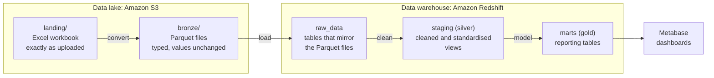

# 02 · Data Layers

This document follows the data on its journey, from the Excel workbook that gets uploaded to the tables that power the dashboards. Along the way, it passes through a number of layers, each with a specific role in preparing and organising the data.

Understanding what happens at each stage makes it easier to see how the pipeline preserves the original source, handles cleaning and produces the reporting tables used by Metabase.

## The layers at a glance



| Layer | Where it lives | Format | What it holds | Built by |
|---|---|---|---|---|
| **Landing** | S3, `landing/` | Excel (`.xlsx`) | The original workbook, untouched | Whoever uploads the file |
| **Bronze** | S3, `bronze/` | Parquet | A typed copy of the data, with values unchanged | Convert Lambda |
| **Raw** | Redshift, `raw_data` schema | Tables | The same data as bronze, now queryable | Load Lambda |
| **Silver** | Redshift, `staging` schema | Views | Cleaned and standardised data | dbt |
| **Gold** | Redshift, `marts` schema | Tables | Tables designed for reporting | dbt |

The names bronze, silver and gold come from a widely used pattern called the *medallion architecture*. The idea is to keep data preparation in distinct stages, with each layer building on the one before it. This makes it possible to inspect what changed at each stage and trace results back to the original source.

**Why use separate layers?**

If everything were cleaned and transformed in one step, it would be harder to identify where a problem was introduced. Keeping the layers separate means the original data remains available, each stage can be inspected independently, and downstream layers can be rebuilt from the data that came before them.

## Landing: the workbook as it arrived

The workbook is saved in the `landing/` folder exactly as it was uploaded. Nothing in the pipeline changes the original file. The S3 bucket has versioning enabled, so previous versions can be recovered if a file is overwritten.

The workbook contains three sheets, which become three tables throughout the rest of the pipeline:

| Sheet | Becomes the table | Rows in the last verified workbook |
|---|---|---:|
| Events | `events` | 48,000 |
| Customers | `customers` | 4,000 |
| Products | `products` | 101 |

These row counts describe the source workbook used during the last verification. They are not fixed limits, and will change if a different workbook is uploaded.

## Bronze: the same data, in a better format

The convert step reads each worksheet and writes it out as a Parquet file. This changes the storage format and assigns appropriate data types to the columns, such as whole numbers, exact decimals for monetary values and timestamps.

The values themselves are preserved at this stage. Entries such as `N/A` and empty text are carried into bronze as they appear in the workbook. Cleaning and standardisation happen later in silver.

Each table is stored in a folder named after the workbook's fingerprint:

```text
bronze/
├── events/run_id=<fingerprint>/part-0.parquet
├── customers/run_id=<fingerprint>/part-0.parquet
├── products/run_id=<fingerprint>/part-0.parquet
└── _manifests/manifest_<fingerprint>.json
```

The manifest is a small summary file that records the fingerprint, the source file name and the row count for each table.

### The fingerprint

Every workbook is assigned a fingerprint calculated from its contents using SHA-256. This produces a 64-character hexadecimal value.

Two workbooks with identical contents produce the same fingerprint, while a change to the contents produces a different one. The pipeline uses this value as the `run_id`, which helps it identify the data belonging to a particular workbook and safely handle repeated uploads.

### Three extra columns

The convert step adds three metadata columns to every table. These make it possible to trace individual records back to the workbook they came from.

| Column | What it records |
|---|---|
| `_run_id` | The fingerprint of the workbook the row came from |
| `_source_file` | The name of the workbook |
| `_ingested_at` | When the file was converted |

## Raw: the data in the warehouse

The load step copies the Parquet files into Redshift tables in the `raw_data` schema. These tables retain the same columns as the bronze files, including the three metadata columns.

No cleaning takes place here. Raw is a queryable copy of the data that was