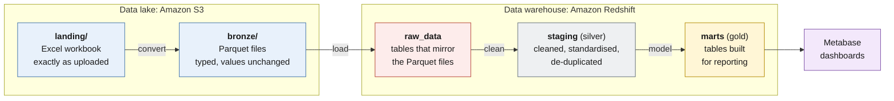

# Data layers

This document follows the data from the moment an Excel workbook is uploaded to the point where it becomes available for analysis in Metabase. Along the way, the data passes through several layers, each serving a different purpose in the pipeline.

Understanding how these layers work, what they contain and how they relate to one another provides a clearer picture of the project's data architecture and the transformations that take place at each stage.

## The layers at a glance



The pipeline uses five main data layers, spread across Amazon S3 and Amazon Redshift.

| Layer | Where it lives | Format | What it holds | Built by |
|---|---|---|---|---|
| **Landing** | S3, `landing/` | Excel (`.xlsx`) | The original workbook, untouched | Whoever uploads the file |
| **Bronze** | S3, `bronze/` | Parquet | A typed copy of the data, with values unchanged | The convert Lambda function |
| **Raw** | Redshift, `raw_data` schema | Tables | The same data as bronze, now queryable | The load Lambda function |
| **Silver** | Redshift, `staging` schema | Views | Cleaned and standardised data | dbt |
| **Gold** | Redshift, `marts` schema | Tables | Tables designed for reporting | dbt |

The bronze, silver and gold naming convention comes from a data management pattern known as the *medallion architecture*. It organises data into progressively refined layers, with each stage building on the one before it.

The idea is to keep ingestion, cleaning and analytical modelling separate. This makes it easier to understand where changes are introduced, inspect the data at different stages and rebuild downstream layers when transformation logic needs to change.

**Why this approach:** Keeping the layers separate provides a clearer picture of the data's journey through the pipeline. If an issue appears in a reporting table, for example, the earlier layers can be inspected to determine whether it originated in the source data, during ingestion or in one of the transformations. It also means downstream layers can be rebuilt without having to start the entire ingestion process again.

## Landing: the workbook as it arrived

The landing layer is the entry point for new data. Whenever a workbook is uploaded, it is stored in the `landing/` folder of the project's Amazon S3 bucket.

The original file is preserved exactly as it was uploaded. The pipeline does not modify the workbook or overwrite its contents during processing. S3 bucket versioning is also enabled, allowing previous versions of an object to be recovered if a file is overwritten.

The source workbook contains three sheets, each representing a different part of the dataset. During processing, each sheet becomes its own table in the subsequent layers.

| Sheet | Becomes the table | Rows |
|---|---|---:|
| Events | `events` | 48,000 |
| Customers | `customers` | 4,000 |
| Products | `products` | 101 |

Keeping the original workbook available provides a reference point for the rest of the pipeline. If something needs to be investigated or a downstream layer needs to be rebuilt, the source file remains accessible in its original form.

## Bronze: the same data in a better format

Once the workbook passes the initial validation, the conversion Lambda function reads each sheet and writes it to a Parquet file.

This stage changes the storage format and assigns appropriate data types to the columns. For example, monetary values are represented using exact decimal types, while timestamps and whole numbers are given their corresponding types. The underlying values, however, are preserved.

This distinction is important. Bronze is not where the business data is cleaned or standardised. Entries such as `N/A` and empty text are retained as they appear in the original workbook. The purpose of this stage is to produce a consistent, typed format that is more suitable for the subsequent processing steps.

Each table is stored in a directory associated with the fingerprint of the workbook that produced it.

```text
bronze/
├── events/run_id=<fingerprint>/part-0.parquet
├── customers/run_id=<fingerprint>/part-0.parquet
├── products/run_id=<fingerprint>/part-0.parquet
└── _manifests/manifest_<fingerprint>.json
```

The manifest is a small JSON file generated during conversion. It records information about the ingestion, including the workbook's fingerprint, the original filename and the number of rows written for each table.

### The fingerprint

Every workbook is assigned a fingerprint calculated from its contents using SHA-256. SHA-256 is a cryptographic hashing algorithm that produces a fixed-length 64-character hexadecimal value.

The fingerprint acts as an identifier for the contents of the workbook:

- Two workbooks with identical contents produce the same fingerprint.
- A change to the workbook's contents produces a different fingerprint.

Within the pipeline, this value is referred to as the `run_id`. It is carried through the subsequent processing stages and plays an important role in identifying records belonging to a particular ingestion.

This is also what makes it possible to process the same workbook again without introducing duplicate records into the warehouse.

### Tracking where the data came from

In addition to the original columns, the conversion process adds three metadata columns to every table. These provide a way to trace individual records back to the workbook and ingestion that produced them.

| Column | What it records |
|---|---|
| `_run_id` | The fingerprint of the workbook the row came from. |
| `_source_file` | The name of the original workbook. |
| `_ingested_at` | The timestamp indicating when the file was converted. |

These columns are retained as the data moves into Redshift, making ingestion-level traceability available throughout the warehouse.

## Raw: the data in the warehouse

After conversion, the Parquet files are loaded into Amazon Redshift Serverless by the load Lambda function.

The files are copied into three corresponding tables in the `raw_data` schema: `events`, `customers` and `products`. Their columns match those in the Parquet files, including the three metadata columns added during conversion.

At this stage, the data remains unchanged. No cleaning, standardisation or business transformations take place during the load. The raw tables provide a queryable representation of the ingested data, preserving what arrived from the bronze layer.

One small naming detail worth mentioning: the schema is called `raw_data` rather than simply `raw` because `RAW` is a reserved word in Amazon Redshift.

### Loading safely

The loading process is designed to handle repeated executions without accumulating duplicate records.

For each of the three tables, the load follows the same sequence:

1. **Delete:** Remove any existing rows associated with the current workbook's fingerprint.
2. **Copy:** Load the corresponding Parquet files into the table.
3. **Record:** Write the outcome of the load to the ingestion log.

All nine of these statements, together with a final validation check, execute within a single database transaction. This means the operation is treated as one unit: either everything succeeds and the changes are committed, or a failure causes the transaction to roll back.

This provides two important safeguards:

- **Repeated uploads:** If the same workbook is processed again, its existing records are replaced rather than appended, preventing duplicate data.
- **Failed loads:** If the operation fails partway through, the preceding deletions are rolled back, leaving the warehouse in its previous state.

This loading strategy is what allows the pipeline to be safely re-run. The underlying implementation and its design rationale are discussed further in the [Overview](01-overview.md).

### The load log

In addition to the raw data tables, the warehouse maintains an operational log in `ops.load_log`.

This table records the history of individual loads, including the workbook fingerprint, table name, source filename, number of rows loaded and the time of execution.

Unlike the raw tables, which replace records associated with a repeated fingerprint, the load log is append-only. Each execution creates new entries, even when the same workbook is processed multiple times.

This distinction is intentional. The raw tables represent the current loaded data, while the log provides a historical record of what the pipeline has processed.

## Silver: cleaned and standardised data

Once the raw data is available in Redshift, dbt handles the next stage of processing.

The silver layer lives in the `staging` schema and consists of three views:

- `stg_customers`
- `stg_events`
- `stg_products`

These models apply the cleaning and standardisation rules needed to make the data more consistent for downstream analysis.

Unlike the raw tables, the silver models are views rather than physical tables. They do not store separate copies of the data. Instead, they apply their SQL transformations against the underlying raw tables whenever they are queried.

The same general cleaning principles are applied across the three models, with the following rules covering the main changes:

| Rule | What it does | Example from this dataset |
|---|---|---|
| **Trim text** | Removes unnecessary spaces at the beginning and end of text values. | Text values with leading or trailing whitespace are standardised. |
| **Convert empty text and `N/A` to nulls** | Replaces these representations of missing information with proper SQL null values, allowing them to be handled correctly in queries and calculations. | 31,020 of the 48,000 events have `N/A` as the discount code, indicating that no discount was used. |
| **Label blank regions** | Assigns the label `North America` to records with missing region information. | 19,579 events have no region recorded, and these relate to the US and Canada. |
| **Remove duplicates** | When the same ID appears more than once, retains only the most recently loaded row. | Duplicate identifiers are reduced to a single retained record. |

The cleaning logic is deliberately defined through explicit rules rather than arbitrary replacements. Where a value is missing or needs standardisation, the models apply the documented treatment for that particular field.

**Why this approach:** Keeping the cleaning logic in dbt separates data standardisation from the initial file conversion. The rules are expressed in SQL, maintained in version control and supported by automated tests. If a rule needs to change, the relevant model can be updated and rebuilt using the data already available in the warehouse.

This also makes the transformations easier to inspect and understand than if the same logic were embedded in the ingestion scripts.

## Gold: ready for reporting

The gold layer is where the cleaned data is organised into datasets designed specifically for analysis.

Rather than requiring dashboard queries to repeatedly join tables, calculate metrics and aggregate records, dbt prepares the tables needed to answer the project's analytical questions.

These models are stored as physical tables in the `marts` schema and rebuilt during each pipeline run. Metabase connects to this schema to retrieve the data used in its dashboards.

The gold layer contains three core analytical tables, followed by seven summary tables that provide more focused views of sales and customer performance.

### Dimensions and facts

The core gold models follow a dimensional modelling approach, using a central fact table supported by dimension tables.

A fact table captures measurable business events, while dimension tables provide additional context about the people, products or other entities involved in those events.

In this project, the structure consists of:

| Table | One row per | Role |
|---|---|---|
| `fct_transactions` | Order or invoice (48,000 rows) | The central fact table containing the transaction records and measures used for analysis. |
| `dim_customers` | Customer (4,000 rows) | Provides customer attributes used to analyse purchasing behaviour and customer segments. |
| `dim_products` | Product (101 rows) | Provides product information for analysing sales across products and categories. |

The fact table also includes additional fields that make reporting and analysis more convenient. These include the day and month of each event, whether a discount was applied, the discount amount in US dollars, and revenue figures both including and excluding tax.

There are two details about the source data that are particularly important when interpreting the resulting models.

- **Orders and invoices are treated as separate transactions.** The Events sheet contains both order and invoice records. An initial comparison found that fewer than 1% of invoices matched an order for the same customer, product and amount. They are therefore retained as separate events rather than treated as duplicate records. Both contribute to the revenue figures, while the `event_type` column makes it possible to distinguish between them during analysis.

- **The source revenue includes tax.** The original revenue figure is retained in gold as `revenue_usd_incl_tax`. An additional measure, `revenue_usd_ex_tax`, represents revenue after tax has been removed and the amount converted to US dollars. Keeping both measures allows the dashboards to examine revenue from either perspective.

### Summary tables

Alongside the fact and dimension tables, the gold layer contains seven summary tables. Each is built around a particular area of analysis, providing pre-aggregated data that can be used directly in the dashboards.

| Table | Summarises by | Helps answer |
|---|---|---|
| `revenue_by_month_region` | Month, region and event type | How does revenue change over time and across regions? |
| `product_performance` | Product | Which products and categories generate the most revenue? |
| `refund_summary` | Product | How frequently are purchases refunded? |
| `refund_reasons` | Refund reason | What are the reported reasons for refunds? |
| `channel_payment_summary` | Sales channel and payment method | Which channels and payment methods perform best? |
| `customer_segments` | Segment, age band and acquisition channel | Which customer groups are the most valuable? |
| `discount_impact` | Discount code | How do discounts influence order sizes and revenue? |

These summary models make the reporting layer more straightforward to work with. Instead of rebuilding the same aggregations in individual dashboard queries, Metabase can read from datasets that have already been shaped around the questions being explored.

The complete list of columns, along with their descriptions and data types, is available in the [Data model](05-data-model.md) document.

## Keeping the layers honest

Moving data through several processing stages introduces opportunities for inconsistencies. A conversion issue, an unexpected transformation or an incorrect join can affect the results even when the pipeline completes without an execution error.

To help catch these problems, the project uses a series of data quality checks that validate the data across the different layers.

Some of the key checks include:

- **Row counts:** The original row counts of 48,000 events, 4,000 customers and 101 products are preserved across bronze, raw and silver. The gold fact table also contains all 48,000 events.
- **Identifier integrity:** IDs are checked for uniqueness and non-null values in silver and gold. Relationships are also validated to ensure that every event references an existing customer and product.
- **Revenue reconciliation:** A test compares the total revenue in gold against the corresponding value in silver. The build fails if the difference exceeds one cent.

These checks provide a way to verify that the transformations are behaving as expected and that important information is not being lost or unintentionally changed as the data moves through the pipeline.

The complete list of tests, their implementation and the conditions they validate are covered in [Data model](05-data-model.md).

## Who can see what

Access to the different layers is restricted according to the responsibilities of the components that use them.

| Layer | Who reads it |
|---|---|
| Landing and bronze | The pipeline's own functions |
| Raw and silver | dbt and the pipeline, through the administrator login |
| Gold | Metabase, through a read-only login with access limited to the `marts` schema |

This separation is particularly important for the reporting layer. Metabase only needs access to the finished analytical datasets; it does not need to query the original files, raw tables or intermediate transformation models.

By limiting its database access to the gold layer, the project keeps the reporting environment separate from the ingestion and transformation processes.

