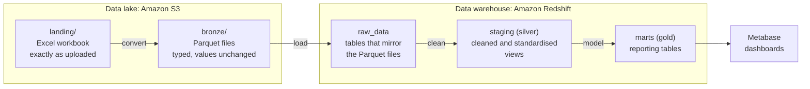

# 02 · Data Layers

This document follows the data on its journey, from the Excel workbook that gets uploaded to the tables that power the dashboards. Along the way, it passes through a number of layers, each with a specific role in preparing and organising the data.

Understanding what happens at each stage makes it easier to see how the pipeline preserves the original source, handles cleaning and produces the reporting tables used by Metabase.

## The layers at a glance



| Layer | Where it lives | Format | What it holds | Built by |
|---|---|---|---|---|
| **Landing** | S3, `landing/` | Excel (`.xlsx`) | The original workbook, untouched | Whoever uploads the file |
| **Bronze** | S3, `bronze/` | Parquet | A typed copy of the data, with values unchanged | Convert Lambda |
| **Raw** | Redshift, `raw_data` schema | Tables | The same data as bronze, now queryable | Load Lambda |
| **Silver** | Redshift, `staging` schema | Views | Cleaned and standardised data | dbt |
| **Gold** | Redshift, `marts` schema | Tables | Tables designed for reporting | dbt |

The names bronze, silver and gold come from a widely used pattern called the *medallion architecture*. The idea is to keep data preparation in distinct stages, with each layer building on the one before it. This makes it possible to inspect what changed at each stage and trace results back to the original source.

**Why use separate layers?**

If everything were cleaned and transformed in one step, it would be harder to identify where a problem was introduced. Keeping the layers separate means the original data remains available, each stage can be inspected independently, and downstream layers can be rebuilt from the data that came before them.

## Landing: the workbook as it arrived

The workbook is saved in the `landing/` folder exactly as it was uploaded. Nothing in the pipeline changes the original file. The S3 bucket has versioning enabled, so previous versions can be recovered if a file is overwritten.

The workbook contains three sheets, which become three tables throughout the rest of the pipeline:

| Sheet | Becomes the table | Rows in the last verified workbook |
|---|---|---:|
| Events | `events` | 48,000 |
| Customers | `customers` | 4,000 |
| Products | `products` | 101 |

These row counts describe the source workbook used during the last verification. They are not fixed limits, and will change if a different workbook is uploaded.

## Bronze: the same data, in a better format

The convert step reads each worksheet and writes it out as a Parquet file. This changes the storage format and assigns appropriate data types to the columns, such as whole numbers, exact decimals for monetary values and timestamps.

The values themselves are preserved at this stage. Entries such as `N/A` and empty text are carried into bronze as they appear in the workbook. Cleaning and standardisation happen later in silver.

Each table is stored in a folder named after the workbook's fingerprint:

```text
bronze/
├── events/run_id=<fingerprint>/part-0.parquet
├── customers/run_id=<fingerprint>/part-0.parquet
├── products/run_id=<fingerprint>/part-0.parquet
└── _manifests/manifest_<fingerprint>.json
```

The manifest is a small summary file that records the fingerprint, the source file name and the row count for each table.

### The fingerprint

Every workbook is assigned a fingerprint calculated from its contents using SHA-256. This produces a 64-character hexadecimal value.

Two workbooks with identical contents produce the same fingerprint, while a change to the contents produces a different one. The pipeline uses this value as the `run_id`, which helps it identify the data belonging to a particular workbook and safely handle repeated uploads.

### Three extra columns

The convert step adds three metadata columns to every table. These make it possible to trace individual records back to the workbook they came from.

| Column | What it records |
|---|---|
| `_run_id` | The fingerprint of the workbook the row came from |
| `_source_file` | The name of the workbook |
| `_ingested_at` | When the file was converted |

## Raw: the data in the warehouse

The load step copies the Parquet files into Redshift tables in the `raw_data` schema. These tables retain the same columns as the bronze files, including the three metadata columns.

No cleaning takes place here. Raw is a queryable copy of the data that was loaded from S3, which means any problem found later can be compared against exactly what arrived.

> **Why is the schema called `raw_data`?** `raw` is a reserved word in Redshift, so it cannot be used as a schema name without awkward quoting.

### How a load works

For each of the three tables, the load follows the same sequence:

1. Deletes any rows already loaded with the same `run_id`.
2. Copies that run's Parquet files from `bronze/` into the corresponding Redshift table.
3. Records the load in `ops.load_log`, including the table, the `run_id` and the number of rows loaded.

All of the statements are sent together as a single transaction. This means the load either completes across all three tables or is rolled back if something goes wrong.

The same workbook can therefore be processed again without accumulating duplicate rows in raw. Its existing records are replaced, while `ops.load_log` remains append-only. Each successful load adds another entry, preserving a history of the files processed.

### When the workbook changes

A different workbook produces a different fingerprint, so its rows are loaded alongside the records from earlier runs rather than replacing them.

Raw consequently retains the history of what has been loaded. The `_run_id` and `_ingested_at` columns help identify which run each record belongs to.

This is useful for tracking changes between workbook versions, but it also means raw can contain multiple versions of the same customer, product or event. Silver handles that when preparing the data for reporting.

## Silver: cleaned and standardised

Silver lives in the `staging` schema and is made up of three views, one for each table: `stg_events`, `stg_customers` and `stg_products`. They are built by dbt on top of the raw tables.

Because they are views, silver always reflects whatever is currently in raw. There is nothing to refresh or rebuild.

Silver does three kinds of work.

### 1. Tidying text values

A small reusable dbt macro, `clean_text`, is applied to text columns such as `country`, `channel`, `payment_method` and `currency`. For each value it:

- Trims leading and trailing spaces.
- Turns empty text and `N/A` into a proper `NULL`.

This means missing values are represented in one consistent way, rather than as a mixture of blanks and placeholder text.

### 2. Filling blank regions

A blank `region` in both customers and events is filled with the fixed default `North America`.

This is a simple default applied in both staging models. It is not a lookup based on country, so it is worth keeping in mind when analysing revenue by region.

### 3. Removing duplicates

Because raw keeps every load, the same customer, product or event can appear more than once if the workbook has been uploaded in more than one version. For each ID, silver keeps only the row with the latest `_ingested_at`.

The result is exactly one row per customer, product and event, reflecting the most recently loaded data.

### Tests on silver

dbt runs ten tests against these views every time the pipeline executes:

- `customer_id`, `product_id` and `event_id` must each be unique and not null in their respective models.
- Every event must have a `customer_id` and a `product_id`.
- Each event's customer and product IDs must also exist in `stg_customers` and `stg_products`.

If any of these tests fail, dbt skips the gold models that depend on them and the run is reported as failed, so questionable data does not flow into the reporting layer. The gold tables from the last successful run stay in place until a later run succeeds.

## Gold: ready for reporting

Gold lives in the `marts` schema and contains ten tables built by dbt from silver:

| Group | Tables | Purpose |
|---|---|---|
| Fact | `fct_transactions` | One row per transaction, orders and invoices together |
| Dimensions | `dim_customers`, `dim_products` | Descriptions of customers and products |
| Summaries | `revenue_by_month_region`, `product_performance`, `refund_summary`, `refund_reasons`, `channel_payment_summary`, `customer_segments`, `discount_impact` | Pre-aggregated answers to the questions the dashboards ask |

At the last verified run, `fct_transactions` held 48,000 rows, `dim_customers` 4,000 and `dim_products` 101.

The fact and dimension tables provide the core structure for analysis, while the summary tables bring together commonly used measures at different levels of detail. This gives the dashboards prepared data to work with instead of having to repeat those aggregations in every chart.

### Revenue, with and without tax

The source's net revenue includes tax. To make both views available for analysis, the fact table carries two measures:

- `revenue_usd_incl_tax`: the source's own USD figure, with tax included.
- `revenue_usd_ex_tax`: calculated as `(net_revenue_local − tax_local) × fx_rate_to_usd`.

This distinction matters when comparing revenue figures or interpreting the dashboard totals. Unless stated otherwise, the reporting tables use tax-inclusive revenue.

Each table, column and calculation is described in [05 · Data model](05-data-model.md).

### Rebuilt on every run

There is an important difference between how silver and gold are stored. Staging models are views, while gold models are tables.

Every pipeline run rebuilds all ten gold tables from silver using `dbt build`. There are no incremental models, so each run produces a fresh set of reporting tables based on the current state of silver.

For the same reason, gold tables should not be edited by hand. Any manual changes would be overwritten by the next pipeline run. To change how a table is built, update the corresponding dbt model instead.

### Gold lands in `marts`

By default, dbt joins the connection's default schema (`staging`) with a model's custom schema (`marts`), which would produce a schema called `staging_marts`.

A custom `generate_schema_name` macro overrides this behaviour so the gold models are created directly in `marts`. This is also the schema exposed to Metabase, keeping the reporting tables separate from the intermediate data used by the pipeline.

## Tests and checks

Automated tests and manual checks serve different purposes, so it is useful to distinguish between them.

**Automated checks: 19 dbt tests on every run.**

| Where | Tests |
|---|---|
| Silver | 10: unique and not-null keys, plus the links between events, customers and products |
| Gold | 8: unique and not-null keys on the fact and dimensions, plus the links from the fact to both dimensions |
| Custom | 1: `assert_revenue_matches_staging` confirms total revenue in gold equals total revenue in silver |

The custom revenue test provides an additional check that the transformation has not lost or double-counted revenue while building the reporting layer.

**Manual checks: row counts at the last verified run.**

The counts shown earlier in this document (48,000 events, 4,000 customers and 101 products) were recorded through manual checks, not automated dbt tests. They are useful for verifying the expected size of the core tables, but they are not fixed values and will change if the source workbook changes.

## Who can see which layer

Access is separated according to what each part of the project needs to do.

| Layer | Who can read it |
|---|---|
| Landing and bronze | Anyone with access to the S3 bucket |
| Raw and silver | The warehouse administrator and dbt |
| Gold | The administrator, dbt and the read-only `bi_reader` user that Metabase uses |

Metabase only reads from gold. It does not need access to the original files, raw tables or staging views to serve the dashboards. This keeps the reporting connection limited to the data prepared for analysis.

The access configuration is covered in more detail in [03 · Infrastructure](03-infrastructure.md).

---

**Next:** [03 · Infrastructure](03-infrastructure.md)