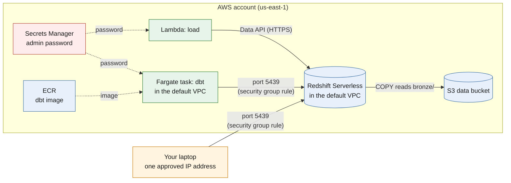

# 03 · Infrastructure

Everything in this project runs on AWS, and Terraform manages the infrastructure. That means the environment can be created, updated or destroyed through code rather than having to configure each resource manually in the AWS console.

This document looks at what Terraform provisions, how the individual resources are configured, and how they communicate with one another. It also covers the access controls and security decisions that shape the environment.

For how these resources work together when a workbook is uploaded, see [04 · Pipeline](04-pipeline.md).

---

## 1. How the Terraform is organised

The Terraform configuration is split into two folders, which are applied separately:

| Folder | Purpose | When it is applied |
|---|---|---|
| `terraform/bootstrap/` | Creates the S3 bucket used to store Terraform's state | Once, at the beginning |
| `terraform/main/` | Creates and manages all the project infrastructure | Whenever infrastructure changes |

**Why keep them separate?**

Terraform needs somewhere to store its state so it can keep track of the resources it manages. However, the remote state bucket has to exist before Terraform can use it.

The bootstrap configuration solves that problem by creating the S3 bucket using local state. Once the bucket is available, the main configuration can use it to store its own state remotely.

Keeping the two configurations separate also protects the state bucket from accidental deletion when the project infrastructure is destroyed. The resources managed by the main configuration can be torn down without taking the state storage down with them.

### Files in `terraform/main/`

The main configuration is divided across several files, with each one responsible for a particular part of the infrastructure.

| File | What it defines |
|---|---|
| `main.tf` | AWS provider, remote state backend and default tags |
| `variables.tf` | Input variables used throughout the configuration |
| `outputs.tf` | Values printed after `terraform apply`, including endpoints, ARNs and resource names |
| `storage.tf` | S3 data bucket and its configuration |
| `lambda.tf` | Convert Lambda and its IAM role |
| `load.tf` | Load Lambda and its IAM role |
| `redshift.tf` | Redshift Serverless, networking, security group and S3 read role |
| `ecr.tf` | Container registry for the dbt image |
| `ecs.tf` | ECS cluster, dbt task definition, logging and task security group |
| `sns.tf` | Alert topic and email subscription |
| `pipeline.tf` | Step Functions state machine and its execution role |
| `trigger.tf` | EventBridge rule that starts the pipeline |

### State, variables and tags

A few configuration choices apply across the main Terraform project:

- **Remote state:** The main configuration stores its state in the S3 bucket `sammy-ecom-elt-tfstate`. It uses Terraform's native lockfile mechanism (`use_lockfile`) to prevent two operations from modifying the same state at the same time.
- **AWS provider:** The project uses AWS provider version `~> 6.0` and deploys resources in `us-east-1`.
- **Default tags:** Terraform automatically applies `project=ecommerce-elt`, `env=dev`, `owner=sammy` and `managed_by=terraform` to resources. These tags make it easier to identify and manage the infrastructure belonging to the project in the AWS console.

The configuration also uses the following input variables:

| Variable | Purpose | Default |
|---|---|---|
| `region` | AWS region for the deployment | `us-east-1` |
| `project` | Prefix used when naming resources | `ecommerce-elt` |
| `env` | Environment tag | `dev` |
| `my_ip` | Public IP address allowed to connect to Redshift | None |
| `alert_email` | Email address that receives pipeline alerts | None |

The two personal values, `my_ip` and `alert_email`, are supplied through `terraform.tfvars`. This file is included in `.gitignore`, keeping personal configuration out of the repository.

---

## 2. Resources by component

This section looks at the AWS resources individually, including their main configuration settings and the reasons behind some of the choices.

### S3 data bucket

A single S3 bucket holds the project's data lake and the build artefacts needed to deploy the Lambda functions.

The data lake uses `landing/` and `bronze/`, while `artifacts/` stores deployment packages.

| Setting | Configuration | Why it matters |
|---|---|---|
| Versioning | Enabled | Allows previous versions of objects to be recovered after an overwrite |
| Encryption | AES-256 server-side encryption | Encrypts stored objects at rest |
| Public access block | All four options enabled | Prevents the bucket from being made publicly accessible |
| EventBridge notifications | Enabled | Allows S3 to send upload events to EventBridge, which starts the pipeline |

Versioning is particularly useful for the landing area because the original workbook is preserved as uploaded. If a file is accidentally replaced, an earlier version can still be recovered.

### Convert Lambda: `ecom-convert`

The convert Lambda reads the uploaded Excel workbook, processes its worksheets and writes the resulting Parquet files to the `bronze/` area of the S3 bucket.

| Setting | Configuration |
|---|---|
| Runtime | Python 3.12 |
| Memory / timeout | 1024 MB / 120 seconds |
| Package | Approximately 53 MB ZIP file, uploaded to `artifacts/` in S3 and deployed from there |
| Libraries | `openpyxl`, `pyarrow` (built for Linux) |

**Why deploy the package from S3?**

The deployment package is larger than the limit for uploading a ZIP file directly to Lambda. Storing it in S3 and referencing it during deployment allows Terraform to deploy the larger package.

The Linux-built dependencies are also important because the function runs in AWS rather than on the local Windows development environment.

### Load Lambda: `ecom-load`

The load Lambda takes a `run_id` and loads the corresponding Parquet files from S3 into the Redshift warehouse.

| Setting | Configuration |
|---|---|
| Runtime | Python 3.12 |
| Memory / timeout | 128 MB / 300 seconds |
| Package | Built by Terraform from `lambda/load/handler.py` and `sql/03_load.sql` |
| Environment variables | `WORKGROUP`, `DATABASE`, `SECRET_ARN` |
| Redshift connection | Redshift Data API over HTTPS, so the function does not need a VPC attachment |
| Input validation | Checks that `run_id` matches `[0-9a-f]{64}` before using it in SQL |

The `run_id` validation ensures that the value has the expected format of a 64-character hexadecimal SHA-256 fingerprint. This is important because the identifier is used when selecting the files and records associated with a particular workbook run.

The function communicates with Redshift through the Data API rather than a direct database connection. This keeps the Lambda independent of the VPC networking used by the dbt task.

### Redshift Serverless

Redshift Serverless provides the project's data warehouse. It stores the raw data loaded from S3, the cleaned staging views and the reporting tables produced by dbt.

| Setting | Configuration |
|---|---|
| Namespace / workgroup | `ecom` |
| Database | `ecom` |
| Admin user | `admin`, with a password generated and stored by Secrets Manager |
| Base capacity | 4 RPU |
| Maximum capacity | 8 RPU |
| Usage limit | 20 RPU-hours per day; action set to *deactivate* |
| Network | Default VPC and its subnets, with a publicly accessible endpoint |
| Security group | `ecom-redshift` |
| S3 access | IAM role `ecom-redshift-s3-read` |

A few of these settings are worth explaining:

- **Capacity:** The dataset and workload are relatively small, so a base capacity of 4 RPU is sufficient for the project. The maximum of 8 RPU limits how far the workgroup can scale.
- **Usage limit:** The daily limit provides an additional safeguard against unexpected consumption. The configured action is `deactivate`, which switches compute off when the limit is reached. See the [AWS usage-limit documentation](https://docs.aws.amazon.com/redshift/latest/mgmt/serverless-usage-limits.html) for the exact behaviour.
- **S3 access:** Redshift uses the `ecom-redshift-s3-read` IAM role to access the Parquet files. The role allows `GetObject` on `bronze/*`, along with `ListBucket` and `GetBucketLocation` on the bucket. These are the permissions required for the warehouse to read the files during a `COPY` operation.

### ECR repository: `ecom-dbt`

The `ecom-dbt` repository in Amazon Elastic Container Registry (ECR) stores the Docker image used to run dbt.

The image contains dbt and the project's transformation models. When the pipeline reaches the transformation step, the ECS task pulls the image from ECR and runs it on Fargate.

The task definition references the `latest` image tag.

**Updating dbt**

The pipeline does not rebuild the Docker image. It pulls whichever image the `latest` tag points to when the task starts.

This means that whenever you change anything in the `dbt/` directory, you need to rebuild the image and push the updated version to ECR. The next pipeline run will then pick up the new image automatically.

The build and push steps are covered in [06 · Run it yourself](06-run-it-yourself.md).

### ECS cluster and dbt task

Amazon ECS manages the dbt task, while AWS Fargate provides the compute capacity to run it without having to manage servers.

| Setting | Configuration |
|---|---|
| Cluster | `ecom` |
| Task definition | `ecom-dbt` |
| Launch type | Fargate |
| CPU / memory | 512 CPU units / 1024 MB |
| Network mode | `awsvpc` |
| Image | `ecom-dbt:latest` from ECR |
| Database password | `DBT_PASSWORD`, injected from the `password` key in the Secrets Manager secret |
| Logs | CloudWatch log group `/ecs/ecom-dbt`, retained for 14 days |
| Security group | `ecom-dbt-task`, with outbound rules only |
| Execution role | `ecom-dbt-execution`, used to pull the image, retrieve the secret and write logs |

**Public IP without a NAT gateway**

The Fargate task is launched with a public IP so it can pull its image from ECR and reach the AWS services it needs.

This avoids having to provision a NAT gateway for outbound connectivity. A NAT gateway would add a recurring cost that could be significant relative to the size of this project.

Although the task has a public IP, its security group has no inbound rules. External connections therefore cannot initiate traffic into the task.

### Step Functions: `ecom-pipeline`

The Step Functions state machine coordinates the pipeline from the initial workbook conversion through to the final notification.

Its execution role is `ecom-pipeline-sfn`.

| State | What it does | Timeout |
|---|---|---|
| `Convert` | Invokes `ecom-convert` | 300 seconds |
| `Load` | Invokes `ecom-load` | 400 seconds |
| `Transform` | Starts the dbt task on Fargate and waits for it to finish using `ecs:runTask.sync` | 1800 seconds |
| `NotifySuccess` | Publishes a success message to SNS | Not applicable |
| `NotifyFailure` | Publishes a failure alert when a preceding step fails and enters the `Catch` path | Not applicable |
| `Failed` | Marks the execution as failed | Not applicable |

The state machine also handles retries for transient AWS service errors in the Lambda steps. This gives temporary service issues an opportunity to resolve before the execution moves into the failure path.

The full sequence, including the input passed between states and the failure-handling flow, is covered in [04 · Pipeline](04-pipeline.md).

### EventBridge rule: `ecom-new-workbook`

Amazon EventBridge listens for new workbook uploads and starts the state machine when a matching object is created in S3.

The rule is configured as follows:

- **Event pattern:** Matches S3 `Object Created` events where the object key matches `landing/*.xlsx`.
- **Input transformer:** Reshapes the S3 event into the simpler `{"bucket", "key"}` input expected by the Step Functions state machine.
- **Execution role:** Uses `ecom-events-start-pipeline`, which has permission to start this particular state machine and nothing else.

This means the pipeline can start automatically whenever a new Excel workbook is uploaded to the expected location.

### SNS topic: `ecom-pipeline-alerts`

Amazon Simple Notification Service (SNS) handles the pipeline's email notifications.

The `ecom-pipeline-alerts` topic receives messages from the state machine for both successful and failed executions. These messages are delivered to the configured email subscription.

There is one setup step to complete after deployment: the email subscription must be confirmed by clicking the link in the first confirmation email sent by AWS. Until that subscription is confirmed, SNS will not deliver the pipeline alerts.

---

## 3. Access and security

The infrastructure uses separate IAM roles and security groups to control how the different components communicate. The intention is to give each service the access it needs without opening up the rest of the environment.

### Network and access map

The diagram below shows the main connections between the local machine, the AWS services and the Redshift warehouse.

Solid arrows represent network connections, while dotted arrows represent resources or information being supplied to another component, such as a password or container image.

### Who can reach Redshift?

The `ecom-redshift` security group controls inbound access to the warehouse. It allows traffic on **port 5439** from only two sources:

1. **`<YOUR_IP>/32`:** The approved public IP address for the local machine. This is used for running SQL queries and connecting Metabase to Redshift.
2. **The `ecom-dbt-task` security group:** Allows the Fargate task running dbt to connect to the warehouse.

Connections from other sources are refused. Outbound traffic is open so Redshift can access the S3 bucket when reading the Parquet files.

> **Good to know:** The Fargate task connects to Redshift over the VPC's private network, which is why a security group rule referencing the task's security group is enough. The Redshift endpoint itself is publicly reachable, but external access is restricted to the approved IP address.

**What happens when your IP changes?**

The public IP assigned to a home or mobile connection can change. If the local machine or Metabase suddenly starts timing out when connecting to Redshift, the approved IP may need updating.

To do that, update `my_ip` in `terraform.tfvars` and run `terraform apply` from `terraform/main/`. Terraform will update the security group rule to allow the new address.

### IAM roles at a glance

Each AWS component has its own IAM role, with permissions limited to the operations it needs to perform.

| Role | Used by | Permissions |
|---|---|---|
| Convert Lambda role | `ecom-convert` | Read from `landing/`, write to `bronze/` and write logs |
| Load Lambda role | `ecom-load` | Call the Redshift Data API, read the admin secret and write logs |
| `ecom-redshift-s3-read` | Redshift | Read objects under `bronze/*` and list the bucket |
| `ecom-dbt-execution` | dbt Fargate task | Pull the image from ECR, read the secret and write logs |
| `ecom-pipeline-sfn` | Step Functions | Invoke both Lambda functions, run the ECS task and publish messages to SNS |
| `ecom-events-start-pipeline` | EventBridge | Start executions of `ecom-pipeline` |

Keeping these permissions separate means that a component does not automatically inherit the access granted to another part of the pipeline.

### Secrets

The Redshift administrator password is generated and managed by AWS Secrets Manager. It is not hardcoded in Terraform, stored in a Terraform variable or committed to the repository.

Both the load Lambda and the dbt task retrieve the password at runtime:

- The load Lambda uses the secret to authenticate its Redshift Data API operations.
- The dbt task receives the password through the `DBT_PASSWORD` environment variable, which ECS injects from the `password` key in the Secrets Manager secret.

The other personal configuration values, `my_ip` and `alert_email`, are kept in the git-ignored `terraform.tfvars` file rather than committed to source control.

### Read-only access for dashboards

Metabase connects to Redshift using a separate database user rather than the administrator account.

The SQL script `sql/06_bi_user.sql` creates a user named `bi_reader` and grants it access to the `marts` schema. Its permissions are limited to:

- Using the `marts` schema.
- Running `SELECT` queries against its tables, including tables created in the future through default privileges.

The user cannot access the `raw_data` or `staging` schemas, and it cannot modify warehouse data.

The password is supplied on the command line when the SQL script is executed, rather than being stored in the script itself.

This keeps the reporting layer separate from the underlying data and transformation layers. Metabase can query the tables it needs for dashboards without requiring administrator-level access to the warehouse.

### A note on the public endpoint

The Redshift endpoint is publicly accessible, but inbound access is restricted to one approved IP address and protected by database authentication.

For this single-person project, that is a practical trade-off. It provides a straightforward way to connect from a local machine and run Metabase without introducing the additional cost and configuration of a VPN or bastion host.

For a team environment or production deployment, the networking and access model would need to be strengthened. Some sensible next steps would be:

- Make the Redshift workgroup private and connect through a VPN, bastion host or AWS Client VPN.
- Run Metabase inside the VPC rather than connecting from outside AWS.
- Replace the shared administrator secret with per-user or IAM-based authentication.

---

## 4. Outputs

After running `terraform apply`, the command `terraform output` displays the values needed for the remaining setup and deployment steps.

| Output | What it provides |
|---|---|
| `account_id` | AWS account ID used for the deployment |
| `caller_arn` | Identity Terraform is running as |
| `data_bucket` | Name of the S3 data bucket |
| `convert_function` | Name of the convert Lambda |
| `load_function` | Name of the load Lambda |
| `redshift_endpoint` | Redshift hostname used for database connections |
| `redshift_secret` | ARN of the administrator password secret |
| `dbt_repository` | ECR repository URL containing the dbt image |
| `dbt_task_security_group` | Security group ID assigned to the dbt task |
| `default_subnets` | Subnets used when launching the dbt task |
| `alerts_topic` | ARN of the SNS alerts topic |
| `pipeline_arn` | ARN of the Step Functions state machine |

These outputs provide the resource identifiers and connection details used by the subsequent deployment and pipeline steps. They also make it easier to retrieve important infrastructure values without having to look through individual resources in the AWS console.

---

**Next:** [04 · Pipeline](04-pipeline.md)