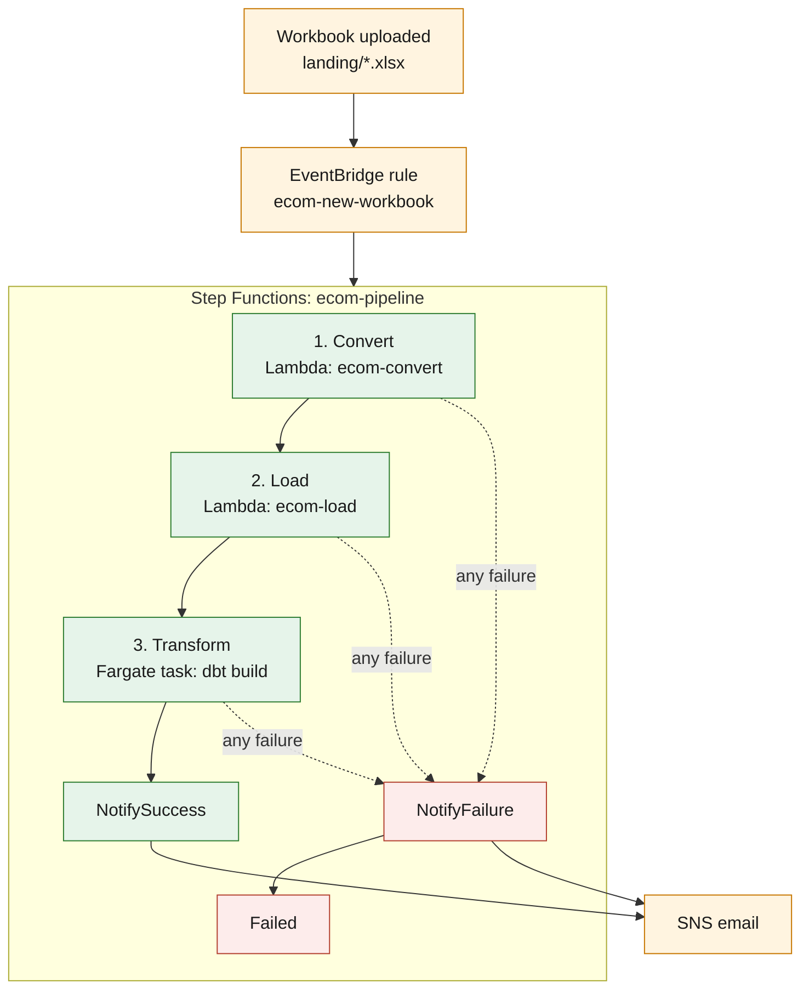

# 04 · Pipeline

This page follows a workbook from the moment it is uploaded to the moment its data is available in the dashboards. The pipeline runs automatically, so there is no need to start each stage manually. Once a workbook is uploaded to the expected location, AWS takes care of processing it, loading the data, running the transformations and sending an email with the outcome.

We'll follow the process in the order it happens, looking at what each step does, what it passes to the next one and how the pipeline handles failures along the way.

For the AWS resources behind each step, see [03 · Infrastructure](03-infrastructure.md). For a closer look at the layers and tables each step produces, see [02 · Data Layers](02-data-layers.md).

---

## 1. The big picture

The pipeline has three main processing steps: Convert, Load and Transform. Amazon EventBridge starts the execution when a new workbook is uploaded, while Step Functions coordinates the steps and handles the success and failure paths.



Solid arrows show the normal processing path. Dotted arrows show the failure path, which any of the three processing steps can take.

Here's a quick look at what happens at each stage:

| Step | What it does | Reads | Writes |
|---|---|---|---|
| Convert | Turns the workbook into Parquet files | `landing/` | `bronze/` |
| Load | Copies that run's Parquet files into Redshift | `bronze/` | `raw_data` tables, `ops.load_log` |
| Transform | Runs dbt to clean, model and test the data | `raw_data` | `staging` views, `marts` tables |

Each step depends on the successful completion of the one before it. If conversion fails, for example, the pipeline does not attempt to load or transform incomplete output.

## 2. The trigger

The process starts with an upload to the S3 bucket.

When a file whose key matches `landing/*.xlsx` is uploaded, S3 sends an *Object Created* event to EventBridge. The rule `ecom-new-workbook` catches the event and starts the `ecom-pipeline` state machine.

Before passing the event to Step Functions, EventBridge reshapes it into a simpler input containing just the bucket and object key:

```json
{
  "bucket": "<your-data-bucket>",
  "key": "landing/<workbook-name>.xlsx"
}
```

That's all the pipeline needs to locate the uploaded workbook.

Files uploaded outside `landing/`, or files that do not have the `.xlsx` extension, are ignored by the rule. This also means that files written by the pipeline itself under `bronze/` cannot trigger another execution.

### Starting a run by hand

Uploading a workbook is the normal way to start the pipeline. However, you can also start an execution manually if you want to process a file that is already in `landing/`.

Save the JSON input above as `input.json`, then run the following command from your project directory:

`C:\Users\Aspiring Hippie\Desktop\Projects\ecommerce-elt`

```powershell
aws stepfunctions start-execution --state-machine-arn <PIPELINE_ARN> --input file://input.json
```

Replace `<PIPELINE_ARN>` with the value of `pipeline_arn` from `terraform output`.

This is useful when troubleshooting a failed execution or when you want to rerun a workbook without uploading it again.

---

## 3. Step 1: Convert

**Lambda: `ecom-convert` | Step Functions timeout: 300 seconds**

The first step takes the original Excel workbook and prepares it for the rest of the pipeline. It reads the workbook from `landing/`, processes its three worksheets and writes a Parquet file for each one.

Here's what happens:

1. The function reads the workbook from `landing/`.
2. It calculates a `run_id` using the SHA-256 hash of the file's contents.
3. It converts the `events`, `customers` and `products` worksheets into Parquet files.
4. It writes the files to `bronze/`, using the fingerprint to organise each run.
5. It creates a manifest containing details about the source file and the data processed.
6. It returns the `run_id` to Step Functions, which passes it to the load step.

The resulting files follow this structure:

```text
bronze/
├── events/run_id=<run_id>/part-0.parquet
├── customers/run_id=<run_id>/part-0.parquet
├── products/run_id=<run_id>/part-0.parquet
└── _manifests/manifest_<run_id>.json
```

The original workbook remains untouched in `landing/`. Conversion changes the storage format and assigns data types, but the actual cleaning and standardisation happen later in silver.

### Why use a hash for the run ID?

The `run_id` is calculated from the file's **contents**, not its name or upload time. This gives the pipeline a consistent way to recognise a particular version of the data.

There are two useful consequences:

- **The same workbook gets the same ID.** Uploading identical contents again produces the same fingerprint and the same output paths. The new conversion therefore replaces the existing Parquet files for that run rather than creating another set.
- **A changed workbook gets a new ID.** Even a small change to the file's contents produces a different fingerprint. Its Parquet files are stored under a separate run ID, keeping the different versions distinguishable.

This approach gives the pipeline a reliable way to track each workbook version throughout the remaining steps.

## 4. Step 2: Load

**Lambda: `ecom-load` | Step Functions timeout: 400 seconds**

Once conversion finishes, Step Functions passes the `run_id` to the load Lambda.

The function first checks that the identifier contains exactly 64 lowercase hexadecimal characters. This is the expected format of the SHA-256 fingerprint and ensures that the value is safe to use in the SQL statements.

It then executes the statements in `sql/03_load.sql` through the Redshift Data API.

For each of the three tables, the load follows the same sequence:

1. **Delete:** Remove any rows already loaded with the current `run_id`.
2. **Copy:** Load that run's Parquet files from S3 into the corresponding `raw_data` table. Redshift reads the files directly from S3 using its own read-only IAM role.
3. **Log:** Insert a record into `ops.load_log`, recording the table, run ID and number of rows loaded.

Across all three tables, this produces nine statements. A final `SELECT` retrieves the result of the operation.

All ten statements are submitted as one batch inside a single transaction. The load therefore either completes across all three tables or rolls back entirely.

### Why it is safe to rerun

The load process is designed to handle repeated executions without leaving duplicate or partially loaded data behind.

- **Delete before copying:** Existing records for the current `run_id` are removed before the new Parquet files are loaded. Running the same workbook again replaces its records instead of appending duplicates.
- **One transaction:** All three tables are loaded as part of the same transaction. If something fails halfway through, the transaction rolls back, including the earlier delete operations.
- **Append-only logging:** `ops.load_log` is never edited or overwritten. Every load operation adds another entry, preserving the history of what was processed.

Every raw record also carries `_run_id`, `_source_file` and `_ingested_at`. These metadata columns make it possible to trace a record back to the workbook and the time it was ingested.

### When the workbook changes

A changed workbook produces a new `run_id`. Its records are therefore loaded alongside the records from earlier runs rather than replacing them.

This is intentional. The raw layer retains the different workbook versions, giving the project a record of the data that has been ingested.

Silver handles this by keeping only the latest row for each ID, based on `_ingested_at`. This means the staging views present the latest available version of each record while raw retains the underlying load history.

## 5. Step 3: Transform

**ECS/Fargate task: `ecom-dbt` | Step Functions timeout: 1,800 seconds**

With the raw data loaded, Step Functions starts the dbt task on Amazon ECS using AWS Fargate.

The state machine uses `ecs:runTask.sync`, which means it waits for the task to finish before moving on. It does not simply start the container and assume the transformation has completed.

The container's default command is `dbt build`. This runs the project's models and tests in dependency order.

There are three main parts to the build:

1. **Staging:** dbt builds the three views in the `staging` schema. These apply the cleaning, standardisation and de-duplication rules to the raw data.
2. **Marts:** dbt builds the reporting tables in the `marts` schema. These include the fact table, two dimensions and seven summary tables.
3. **Tests:** dbt runs the 19 automated tests that check key uniqueness, required values, relationships between fact and dimension tables, and revenue reconciliation between staging and gold.

The staging models are views, so they reflect the latest raw data. The gold models are tables, and all ten are rebuilt from silver on every pipeline run. There are no incremental models in this project.

If a test fails, dbt stops and skips models that depend on the failed step. The task exits with an error, allowing Step Functions to take the failure path rather than reporting a successful execution with an incomplete build.

The task retrieves its database password from Secrets Manager and sends its output to the CloudWatch log group:

`/ecs/ecom-dbt`

This includes the output from individual models and tests, which is useful when investigating a failed transformation.

### Updating dbt

The Fargate task runs whichever Docker image the `latest` tag in ECR points to when the task starts. The pipeline does not rebuild the image automatically.

Whenever you change anything under `dbt/`, you must rebuild the Docker image and push the updated version to ECR. The next pipeline run will then pull the updated image.

The build and push commands are covered in [06 · Run it yourself](06-run-it-yourself.md).

---

## 6. Success, failure and alerts

Once the three processing steps have finished, the state machine follows one of two paths.

| Outcome | What happens | Email subject theme |
|---|---|---|
| All three steps succeed | `NotifySuccess` publishes a message to SNS | Success |
| Any step fails or times out | `NotifyFailure` publishes a message to SNS, then the execution ends as `Failed` | Failure |

A few parts of this process are worth understanding:

- **Retries:** The two Lambda steps retry automatically when they encounter temporary AWS service errors. Errors caused by the data or application code are not retried, since running the same operation again would likely produce the same failure.
- **Timeouts:** Each processing step has its own timeout: 300 seconds for Convert, 400 seconds for Load and 1,800 seconds for Transform. This prevents a stuck operation from holding the execution open indefinitely.
- **Email notifications:** Both success and failure messages are sent to the address configured through `alert_email`. The SNS email subscription must be confirmed once by clicking the link in the first confirmation email AWS sends.

### What a failed run leaves behind

A failed execution does not necessarily mean that nothing was processed. What remains depends on which stage encountered the problem.

| Failed at | What remains |
|---|---|
| Convert | The conversion step did not complete successfully. Any earlier data remains untouched. |
| Load | The Redshift transaction rolls back, so a partial load is not left behind. Earlier warehouse data remains untouched. |
| Transform | The raw data has already been loaded. Some gold tables may not have been rebuilt, or dependent models may have been skipped after a test failure. |

A Transform failure is worth paying particular attention to. The load step may have completed successfully, but the reporting tables are not necessarily all up to date.

Once the cause has been fixed, rerun the same workbook. The load step safely replaces the records for that `run_id`, and dbt rebuilds the gold models from the latest silver data.

---

## 7. Watching a run

Although the pipeline runs automatically, there are several places to inspect what happened during an execution.

| Where | What you can see |
|---|---|
| **Step Functions console → `ecom-pipeline`** | Each execution, the state it reached, how long each step took and the error associated with a failure |
| **CloudWatch Logs: Lambda log groups** | Output from the convert and load functions |
| **CloudWatch Logs: `/ecs/ecom-dbt`** | Full dbt output, including individual model and test results |
| **`ops.load_log` in Redshift** | A permanent record of what was loaded, when it was loaded and how many rows were processed |

If you receive a failure email, a good place to start is the failed execution in the Step Functions console. It highlights the state that failed and provides the associated error message.

For a failure during Transform, the next stop is the `/ecs/ecom-dbt` CloudWatch log group. The dbt output should help identify which model or test caused the build to fail.

For common problems and their fixes, see [08 · Troubleshooting](08-troubleshooting.md).

---

**Next:** [05 · Data Model](05-data-model.md)