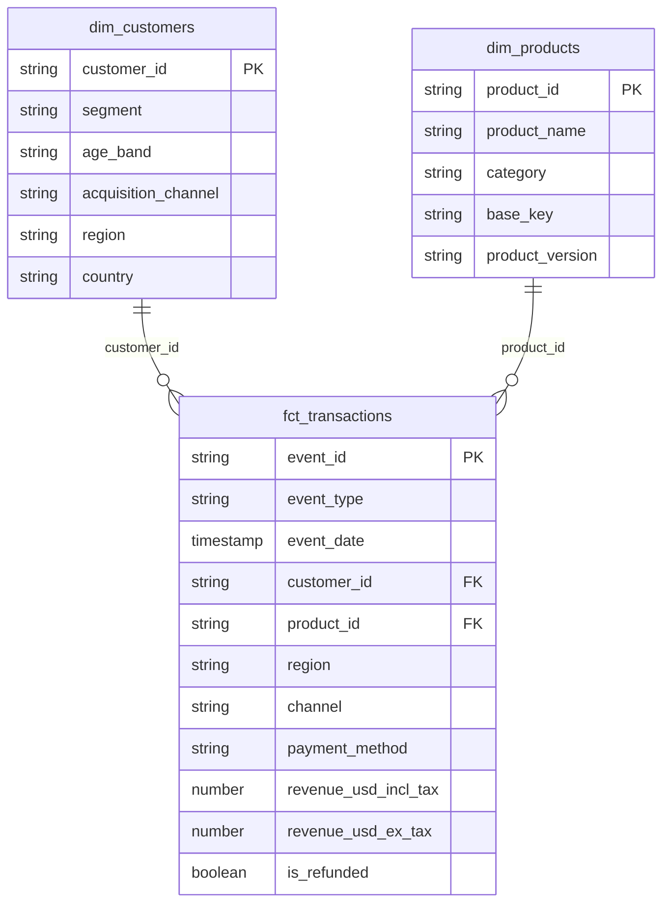

# 05 · Data model

This page describes the **gold layer**: the ten tables in the `marts` schema that dashboards and analysts query. It covers what each table contains, how it is built, and the points worth knowing before you write a query.

For how data reaches this layer, see [02 · Data layers](02-data-layers.md) and [04 · Pipeline](04-pipeline.md).

---

## 1. Shape of the model

The model is a small **star schema**: one fact table of transactions, two dimension tables describing customers and products, and seven pre-aggregated summary tables built from them.



The diagram shows only the key columns; the full lists are below.

| Table | Type | Rows at last verified run | One row per |
|---|---|---|---|
| `fct_transactions` | Fact | 48,000 | Transaction (order or invoice) |
| `dim_customers` | Dimension | 4,000 | Customer |
| `dim_products` | Dimension | 101 | Product |
| `revenue_by_month_region` | Summary | n/a | Month × region × event type |
| `product_performance` | Summary | n/a | Product |
| `refund_summary` | Summary | n/a | Product |
| `refund_reasons` | Summary | n/a | Refund reason |
| `channel_payment_summary` | Summary | n/a | Channel × payment method |
| `customer_segments` | Summary | n/a | Segment × age band × acquisition channel |
| `discount_impact` | Summary | n/a | Discount code (or "No discount") |

Row counts are observations from the last verified run, not automated tests, so they will change if the source workbook changes.

All ten tables are **fully rebuilt on every run** from the silver layer, so they always match the latest cleaned data.

---

## 2. The fact table: `fct_transactions`

Built from `stg_events`. Each row is one transaction, and the table holds both event types:

- **`order`**: a purchase.
- **`invoice`**: a billing event.

Both carry revenue.

| Column | Meaning |
|---|---|
| `event_id` | Unique ID of the transaction (primary key) |
| `event_type` | `order` or `invoice` |
| `event_date` | Full timestamp of the transaction |
| `event_day` | The date part of `event_date` |
| `event_month` | First day of the month, handy for grouping by month |
| `customer_id` | Links to `dim_customers` |
| `product_id` | Links to `dim_products` |
| `country`, `region` | Where the transaction took place |
| `channel` | Sales channel |
| `payment_method` | How the customer paid |
| `currency` | Currency the transaction was made in |
| `quantity` | Units in the transaction |
| `unit_price_local` | Price per unit, in the local currency |
| `discount_code` | Code used, or empty if none |
| `has_discount` | `true` when a discount code was used |
| `discount_local` | Discount amount in the local currency |
| `discount_usd` | Discount converted to USD (`discount_local × fx_rate_to_usd`, rounded to 2 decimals) |
| `tax_local` | Tax in the local currency |
| `net_revenue_local` | Net revenue in the local currency. **This figure includes tax** |
| `fx_rate_to_usd` | Rate used to convert the local currency to USD |
| `revenue_usd_incl_tax` | Revenue in USD including tax (the source's own USD figure) |
| `revenue_usd_ex_tax` | Revenue in USD with tax removed |
| `is_refunded` | `true` if the transaction was refunded |
| `refund_datetime` | When the refund happened |
| `refund_reason` | Why it was refunded |

### The two revenue measures

The source reports net revenue **including tax**. Many analyses want it without, so the model provides both:

```
revenue_usd_incl_tax = net_revenue_usd                                  (as supplied)
revenue_usd_ex_tax   = round((net_revenue_local - tax_local) × fx_rate_to_usd, 2)
```

Use `revenue_usd_incl_tax` for the headline "what customers paid" figure, and `revenue_usd_ex_tax` when you need revenue net of tax. Always say which one a chart uses.

---

## 3. The dimensions

### `dim_customers`

Built from `stg_customers`.

| Column | Meaning |
|---|---|
| `customer_id` | Unique ID (primary key) |
| `signup_date` | When the customer signed up |
| `region`, `country` | Where the customer is. A blank region becomes the default `North America` in silver |
| `currency_preference` | Their preferred currency |
| `segment` | Customer segment |
| `age_band` | Age group |
| `acquisition_channel` | How they were first acquired |

### `dim_products`

Built from `stg_products`.

| Column | Meaning |
|---|---|
| `product_id` | Unique ID (primary key) |
| `product_name` | Display name |
| `category` | Product category |
| `is_subscription` | Whether the product is a subscription |
| `billing_cycle` | Billing period, for subscriptions |
| `base_price_usd` | List price in USD |
| `first_release_date` | When the product was first released |
| `vendor` | Supplier |
| `resale_model` | How the product is resold |
| `base_key` | Shared key that groups versions of the same product |
| `product_version` | Version label |

`base_key` and `product_version` make it possible to roll several versions of one product up into a single product family.

---

## 4. The summary tables

These exist so dashboards read a few small tables instead of scanning 48,000 transactions every time. Each is a straightforward grouping of `fct_transactions`, joined to a dimension where it needs descriptive columns.

### `revenue_by_month_region`
*Grain: month × region × event type.* Revenue over time by region.

| Column | Meaning |
|---|---|
| `event_month`, `region`, `event_type` | The grouping columns |
| `transactions`, `units` | Count of transactions and total units |
| `revenue_usd_incl_tax`, `revenue_usd_ex_tax` | Revenue with and without tax |

### `product_performance`
*Grain: product.* Which products sell best.

Columns: `product_id`, `product_name`, `category`, `transactions`, `units`, `revenue_usd_incl_tax`, `revenue_usd_ex_tax`.

### `refund_summary`
*Grain: product.* How often each product is refunded.

| Column | Meaning |
|---|---|
| `product_id`, `product_name`, `category` | The product |
| `transactions` | All transactions for the product |
| `refunded_transactions` | How many were refunded |
| `refund_rate` | Refunded ÷ all transactions, as a **fraction between 0 and 1** (for example `0.0425` is 4.25%), rounded to 4 decimals |
| `refunded_revenue_usd` | Revenue (incl. tax) of the refunded transactions |

### `refund_reasons`
*Grain: refund reason.* Why customers ask for refunds. Counts only refunded transactions.

Columns: `refund_reason`, `refunded_transactions`, `refunded_revenue_usd`.

### `channel_payment_summary`
*Grain: channel × payment method.* How channels and payment methods compare.

Columns: `channel`, `payment_method`, `transactions`, `units`, `revenue_usd_incl_tax`, `avg_transaction_value_usd`.

### `customer_segments`
*Grain: segment × age band × acquisition channel.* Who the valuable customers are.

| Column | Meaning |
|---|---|
| `segment`, `age_band`, `acquisition_channel` | The customer group |
| `customers` | Distinct customers in the group |
| `transactions` | Their transactions |
| `revenue_usd_incl_tax` | Their total revenue |
| `revenue_per_customer_usd` | Revenue ÷ distinct customers |

### `discount_impact`
*Grain: discount code.* Transactions without a code are grouped under **`No discount`**, so you can compare discounted and full-price behaviour side by side.

Columns: `discount_code`, `transactions`, `avg_units_per_transaction`, `avg_transaction_value_usd`, `total_discount_usd`, `revenue_usd_incl_tax`.

---

## 5. Tests on the gold layer

| Model | Test | What it protects |
|---|---|---|
| `dim_customers` | `customer_id` unique and not null | One row per customer |
| `dim_products` | `product_id` unique and not null | One row per product |
| `fct_transactions` | `event_id` unique and not null | One row per transaction |
| `fct_transactions` | `customer_id` exists in `dim_customers` | No transaction points to an unknown customer |
| `fct_transactions` | `product_id` exists in `dim_products` | No transaction points to an unknown product |

The project's remaining tests sit on the staging models, plus one custom test, `assert_revenue_matches_staging`, which checks that total revenue in gold equals total revenue in silver. In all there are 19 tests, and they run on every pipeline run.

---

## 6. Things worth knowing before you query

- **Orders and invoices are both revenue.** The fact table holds both, and `revenue_by_month_region` keeps them apart through `event_type`. Totalling across both types is valid only if that is what you mean. Filter or split by `event_type` when comparing.
- **Say which revenue you mean.** `revenue_usd_incl_tax` and `revenue_usd_ex_tax` differ by the tax amount. Metabase questions should name the one they use.
- **Refund rate is a fraction.** Multiply by 100, or use a percentage format, when displaying it.
- **Summaries use left joins to the dimensions.** A transaction whose product or customer is missing would appear with empty descriptive columns rather than disappear. The relationship tests are there to make sure that never happens.
- **Summaries are rebuilt every run.** Never edit a gold table by hand; the next run overwrites it. Change the model in `dbt/models/marts/` instead.
- **Dashboards read `marts` only.** The read-only `bi_reader` user cannot see raw or staging data. See [03 · Infrastructure](03-infrastructure.md).

---

**Next:** [06 · Run it yourself](06-run-it-yourself.md)