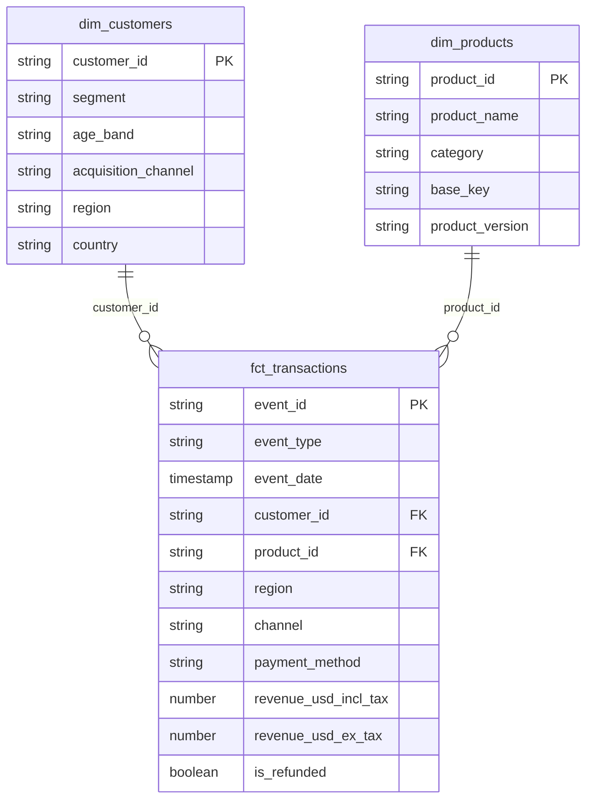

# 05 · Data model

This page covers the **gold layer** of the project: the ten tables in the `marts` schema that dashboards and analysts query. It explains how the tables are organised, what each one contains, and a few details worth keeping in mind when working with the data.

For the earlier stages of the pipeline, see [02 · Data layers](02-data-layers.md) and [04 · Pipeline](04-pipeline.md).

---

## 1. Shape of the model

The gold layer follows a small **star schema**. At its centre is a fact table containing transactions, supported by two dimension tables that provide additional information about customers and products. Seven summary tables sit alongside these, bringing together commonly used metrics for reporting and dashboard analysis.



The diagram focuses on the main relationships and a selection of key columns. The complete column lists are covered in the sections below.

| Table | Type | Rows at last verified run | One row per |
|---|---|---:|---|
| `fct_transactions` | Fact | 48,000 | Transaction (order or invoice) |
| `dim_customers` | Dimension | 4,000 | Customer |
| `dim_products` | Dimension | 101 | Product |
| `revenue_by_month_region` | Summary | n/a | Month × region × event type |
| `product_performance` | Summary | n/a | Product |
| `refund_summary` | Summary | n/a | Product |
| `refund_reasons` | Summary | n/a | Refund reason |
| `channel_payment_summary` | Summary | n/a | Channel × payment method |
| `customer_segments` | Summary | n/a | Segment × age band × acquisition channel |
| `discount_impact` | Summary | n/a | Discount code (or "No discount") |

The row counts are from the last verified run. They are observations, not fixed expectations or automated tests, and may change when the source workbook changes.

All ten gold tables are **fully rebuilt on every pipeline run** using the latest data from the silver layer. There are no incremental models in this layer.

---

## 2. The fact table: `fct_transactions`

Built from `stg_events`, this is the central table in the model. Each row represents one transaction, and it includes both event types found in the source data:

- **`order`**: a purchase.
- **`invoice`**: a billing event.

Both event types carry revenue and are retained in the fact table.

| Column | Meaning |
|---|---|
| `event_id` | Unique ID of the transaction (primary key) |
| `event_type` | `order` or `invoice` |
| `event_date` | Full timestamp of the transaction |
| `event_day` | The date part of `event_date` |
| `event_month` | First day of the month, useful for monthly grouping |
| `customer_id` | Links to `dim_customers` |
| `product_id` | Links to `dim_products` |
| `country`, `region` | Where the transaction took place |
| `channel` | Sales channel |
| `payment_method` | How the customer paid |
| `currency` | Currency used for the transaction |
| `quantity` | Number of units in the transaction |
| `unit_price_local` | Price per unit in the local currency |
| `discount_code` | Discount code used, or empty if none |
| `has_discount` | `true` when a discount code was used |
| `discount_local` | Discount amount in the local currency |
| `discount_usd` | Discount converted to USD (`discount_local × fx_rate_to_usd`), rounded to 2 decimals |
| `tax_local` | Tax amount in the local currency |
| `net_revenue_local` | Net revenue in the local currency. This figure includes tax |
| `fx_rate_to_usd` | Exchange rate used to convert the local currency to USD |
| `revenue_usd_incl_tax` | Revenue in USD including tax, using the source's own USD figure |
| `revenue_usd_ex_tax` | Revenue in USD with tax removed |
| `is_refunded` | `true` if the transaction was refunded |
| `refund_datetime` | When the refund happened |
| `refund_reason` | Reason for the refund |

### Understanding the two revenue measures

The source reports net revenue **including tax**. Since some analyses need to exclude tax, the fact table provides two separate measures:

```sql
revenue_usd_incl_tax = net_revenue_usd
    -- The USD figure supplied by the source

revenue_usd_ex_tax = round(
    (net_revenue_local - tax_local) * fx_rate_to_usd,
    2
)
```

Use `revenue_usd_incl_tax` when reporting the total amount customers paid, and `revenue_usd_ex_tax` when you need revenue with tax removed. The distinction matters when comparing figures across reports, so always make clear which measure a chart or query uses.

---

## 3. The dimensions

The two dimension tables add descriptive information to the transactions. They allow queries to group and filter activity using customer and product attributes without having to work directly with the original source tables.

### `dim_customers`

Built from `stg_customers`, this table contains one row per customer.

| Column | Meaning |
|---|---|
| `customer_id` | Unique customer ID (primary key) |
| `signup_date` | When the customer signed up |
| `region`, `country` | Where the customer is located. A blank region is replaced with the fixed default `North America` in the silver layer |
| `currency_preference` | Customer's preferred currency |
| `segment` | Customer segment |
| `age_band` | Customer's age group |
| `acquisition_channel` | How the customer was first acquired |

### `dim_products`

Built from `stg_products`, this table contains one row per product.

| Column | Meaning |
|---|---|
| `product_id` | Unique product ID (primary key) |
| `product_name` | Product's display name |
| `category` | Product category |
| `is_subscription` | Whether the product is a subscription |
| `billing_cycle` | Billing period, where applicable |
| `base_price_usd` | List price in USD |
| `first_release_date` | When the product was first released |
| `vendor` | Product supplier |
| `resale_model` | How the product is resold |
| `base_key` | Shared key used to group versions of the same product |
| `product_version` | Product version label |

The `base_key` and `product_version` columns are useful when a product has multiple versions. They make it possible to group those versions into a single product family for analysis.

---

## 4. The summary tables

The seven summary tables provide ready-to-query views of common business metrics. Instead of having every dashboard question aggregate the full transaction table, these models handle the groupings in advance. Some also join the fact table to the dimensions to include descriptive fields such as product names and customer segments.

### `revenue_by_month_region`

*Grain: month × region × event type.*

Shows how revenue changes over time across regions, while keeping orders and invoices separate.

| Column | Meaning |
|---|---|
| `event_month`, `region`, `event_type` | The grouping columns |
| `transactions`, `units` | Transaction count and total units |
| `revenue_usd_incl_tax`, `revenue_usd_ex_tax` | Revenue with and without tax |

### `product_performance`

*Grain: product.*

Brings together sales activity and revenue for each product, making it easier to compare product performance.

Columns: `product_id`, `product_name`, `category`, `transactions`, `units`, `revenue_usd_incl_tax`, `revenue_usd_ex_tax`.

### `refund_summary`

*Grain: product.*

Shows refund activity at product level, including how frequently transactions are refunded and the revenue associated with those refunds.

| Column | Meaning |
|---|---|
| `product_id`, `product_name`, `category` | Identifies the product |
| `transactions` | All transactions for the product |
| `refunded_transactions` | Number of transactions that were refunded |
| `refund_rate` | Refunded transactions divided by all transactions, stored as a fraction between 0 and 1 and rounded to 4 decimals |
| `refunded_revenue_usd` | Revenue, including tax, from refunded transactions |

For example, a `refund_rate` of `0.0425` represents 4.25%. Multiply the value by 100 or apply percentage formatting when displaying it.

### `refund_reasons`

*Grain: refund reason.*

Groups refunded transactions by the reason recorded in the source data. It only includes refunded transactions.

Columns: `refund_reason`, `refunded_transactions`, `refunded_revenue_usd`.

### `channel_payment_summary`

*Grain: channel × payment method.*

Compares sales activity across the different sales channels and payment methods.

Columns: `channel`, `payment_method`, `transactions`, `units`, `revenue_usd_incl_tax`, `avg_transaction_value_usd`.

### `customer_segments`

*Grain: segment × age band × acquisition channel.*

Groups customers by their segment, age band and acquisition channel. This makes it possible to compare customer groups by transaction activity and revenue.

| Column | Meaning |
|---|---|
| `segment`, `age_band`, `acquisition_channel` | The customer group |
| `customers` | Number of distinct customers in the group |
| `transactions` | Number of transactions associated with the group |
| `revenue_usd_incl_tax` | Total revenue |
| `revenue_per_customer_usd` | Revenue divided by the number of distinct customers |

### `discount_impact`

*Grain: discount code.*

Provides a way to compare transactions that used discounts with those that did not. Transactions without a discount code are grouped under **`No discount`**, giving them a clear comparison group.

Columns: `discount_code`, `transactions`, `avg_units_per_transaction`, `avg_transaction_value_usd`, `total_discount_usd`, `revenue_usd_incl_tax`.

---

## 5. Tests on the gold layer

The gold models have tests that check key constraints and relationships. These help catch issues such as duplicate identifiers, missing keys and transactions that reference customers or products that do not exist in their respective dimensions.

| Model | Test | What it protects |
|---|---|---|
| `dim_customers` | `customer_id` unique and not null | One row per customer |
| `dim_products` | `product_id` unique and not null | One row per product |
| `fct_transactions` | `event_id` unique and not null | One row per transaction |
| `fct_transactions` | `customer_id` exists in `dim_customers` | No transaction points to an unknown customer |
| `fct_transactions` | `product_id` exists in `dim_products` | No transaction points to an unknown product |

The remaining tests are defined on the staging models. There is also a custom test, `assert_revenue_matches_staging`, which compares total revenue in the gold layer with total revenue in silver.

In total, **19 dbt tests run on every pipeline run**. If a test fails, dbt reports the failure and skips models that depend on the failing test or model.

---

## 6. Things worth knowing before you query

A few details about how the data is modelled can make a difference to the results you get.

- **Orders and invoices both contribute revenue.** The fact table contains both event types, and `revenue_by_month_region` keeps them separate through `event_type`. Adding them together is valid when you want revenue across both types. When comparing orders with invoices, filter or group by `event_type` so the distinction is preserved.

- **Be clear about which revenue measure you use.** `revenue_usd_incl_tax` and `revenue_usd_ex_tax` differ by the tax amount. Make sure Metabase questions and charts identify which measure they use.

- **Refund rate is stored as a fraction.** Multiply it by 100 or use percentage formatting when displaying it. A value of `0.0425`, for example, represents 4.25%.

- **The summary models use left joins to the dimensions.** If a transaction has a customer or product that cannot be matched, it can still appear in the summary with empty descriptive columns rather than being dropped. The relationship tests help catch these unmatched records.

- **Gold tables are rebuilt on every pipeline run.** Any manual changes to a gold table will be overwritten the next time the pipeline runs. If you need to change how a table is built, update the corresponding model under `dbt/models/marts/` instead.

- **Dashboards only access the `marts` schema.** Metabase connects through the read-only `bi_reader` user, which cannot access the raw or staging data. See [03 · Infrastructure](03-infrastructure.md) for the access configuration.

---

**Next:** [06 · Run it yourself](06-run-it-yourself.md)